# Parte 3 - Desarrollo interactivo de app

Misma aplicación (lista de usuarios de JSONPlaceholder) construida en **Vue 3** y **React**.
API: https://jsonplaceholder.typicode.com/users (solo consulta).

**Autor:** Renato Yadaicela
**Frameworks:** Vue (el estudiado en el proyecto grupal) y React.

## Estructura
- `vue-app/`: aplicación en Vue 3 + Vite
- `react-app/`: aplicación en React + Vite
- `evidencias/`: capturas de funcionamiento

## Cómo ejecutar

### Vue
```bash
cd vue-app
npm install
npm run dev
npm run test:unit -- --run
```

### React
```bash
cd react-app
npm install
npm run dev
npm test
```

## Funcionalidades (en ambas apps)
- Consulta con `fetch`, validando `res.ok`, con "Cargando…" y mensaje de error con botón Reintentar.
- Tarjeta reutilizable (nombre, correo, ciudad) que recibe el usuario por props y emite un evento al marcar favorito.
- Búsqueda por nombre mientras se escribe, botón Favorito y contador "Favoritos: N".
- 1 prueba unitaria (`filtrarPorNombre`) con Vitest.
- Extra: botón Reintentar y mensaje "Sin resultados".

## Evidencias

### Vue
| Qué | Captura |
|---|---|
| App corriendo | 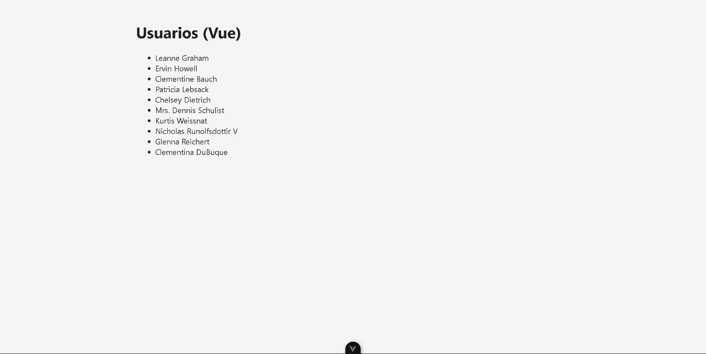 |
| Lista de usuarios | 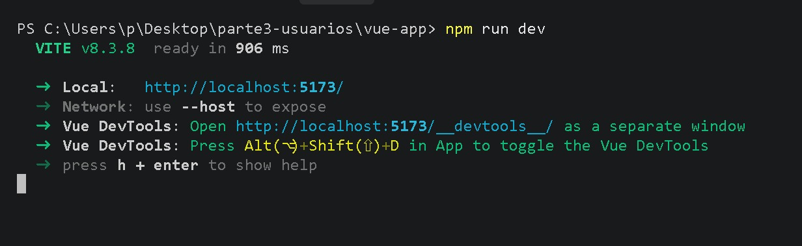 |
| Error de API | 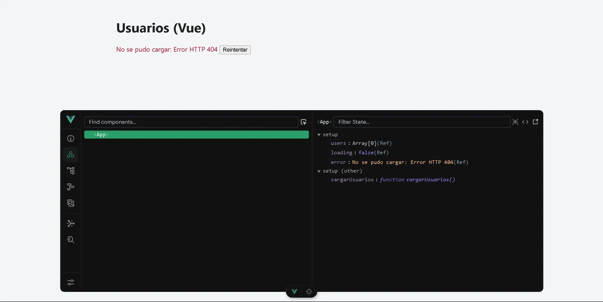 |
| Tarjetas | 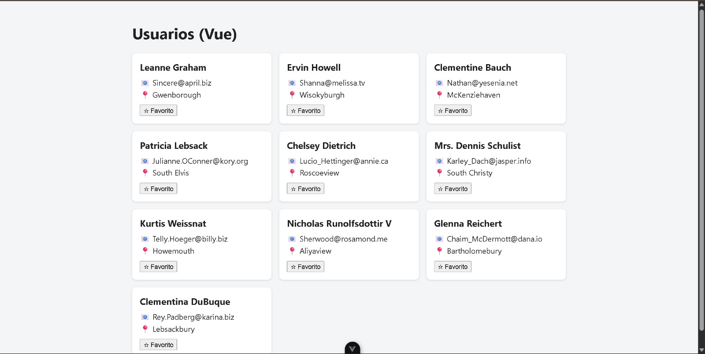 |
| Búsqueda y favoritos | 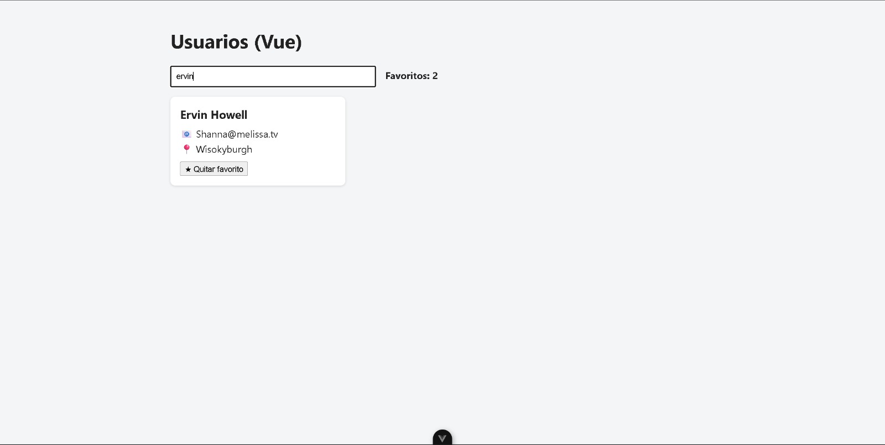 |
| Prueba pasando | 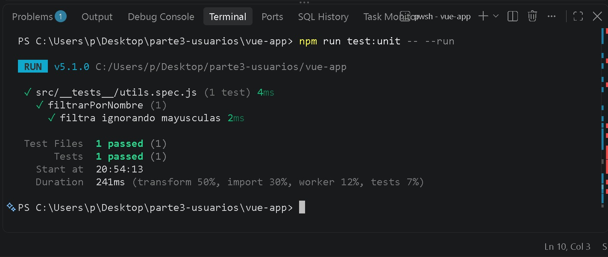 |

### React
| Qué | Captura |
|---|---|
| App corriendo | 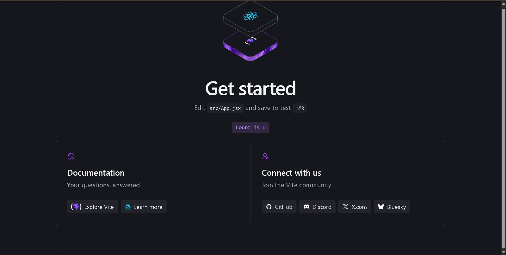 |
| Lista de usuarios | 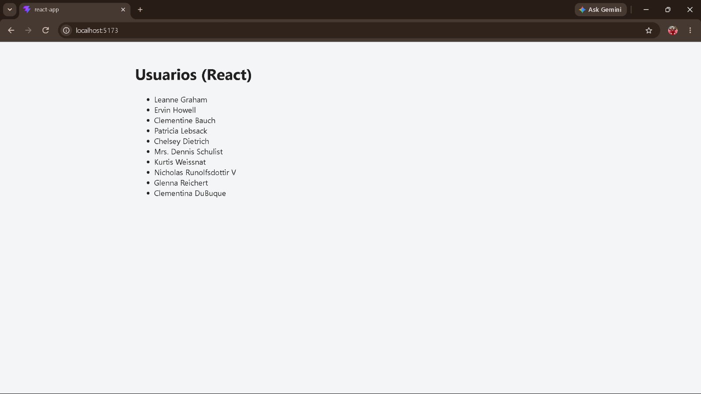 |
| Error de API | 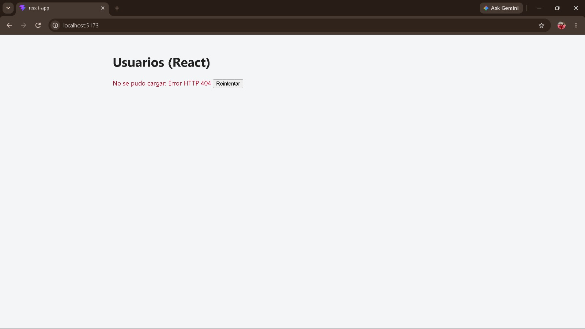 |
| Tarjetas | 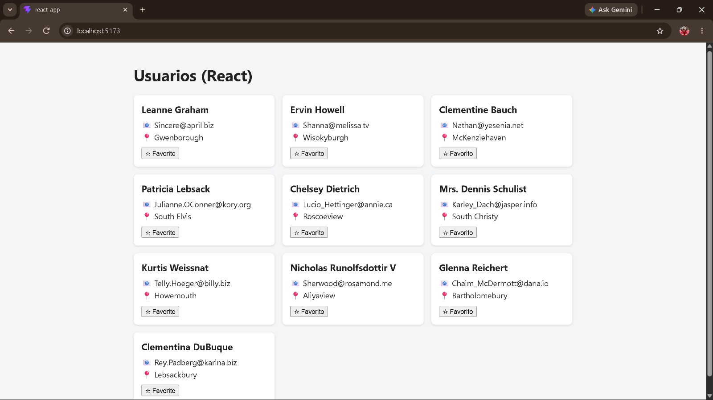 |
| Búsqueda y favoritos | 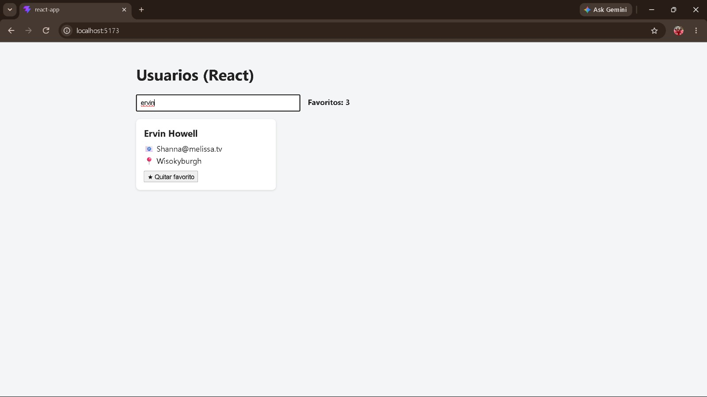 |
| Prueba pasando | 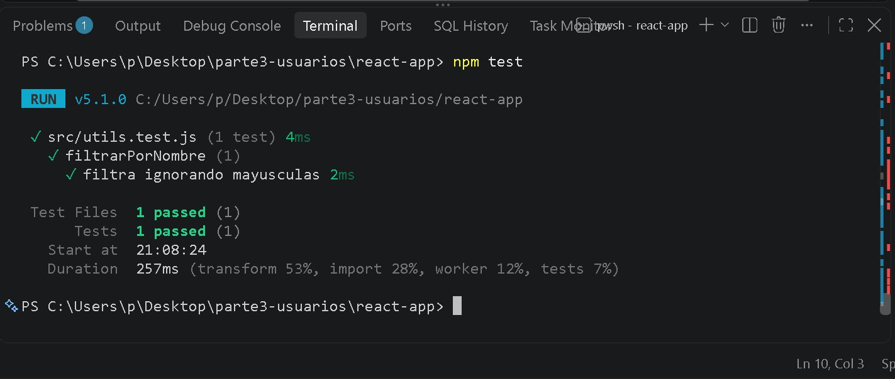 |

## Comparación breve (mi experiencia)
- **Vue:** SFC con `<script setup>`, `ref` y `computed`; el estado se modifica directo (`.value`).
- **React:** JSX y hooks (`useState`, `useEffect`); el estado se actualiza con setters y la lista filtrada se recalcula en cada render.
- La lógica de búsqueda (`utils.js`) fue idéntica en ambos.

## Uso de IA
- **Gemini y NotebookLM:** los use para consultas y dudas de conceptos (props, eventos, estado, hooks, pruebas con Vitest), sin generar codigo bueno correcion de error graves que tuve.
- Todo el codigo fue ejecutado y probado por mi, y puedo explicarlo en la defensa.